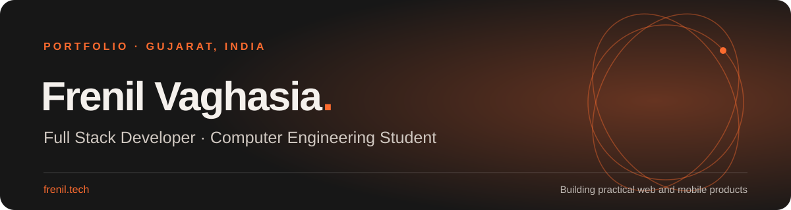

  

<h1 align="center">Hi, I’m Frenil 👋</h1>

  Full stack developer and Computer Engineering student at Dharmsinh Desai University, India. 
  I build practical web and mobile products, from accessible interfaces to the APIs behind them.

  
  

## About

- 🎓 B.Tech Computer Engineering student at Dharmsinh Desai University
- 🧩 Interested in full stack development, product design and useful automation
- 🌱 Building with React, TypeScript, Java, Spring Boot, Python and Flutter
- 📍 Gujarat, India

## Selected projects

| Project | What it does | Stack |
| --- | --- | --- |
| [AI Trip Planner](https://github.com/Frenil0393/Trip-Planner) | Turns a travel prompt into a structured, day-by-day itinerary. | Flutter · Dart · Gemini |
| [CampusLoop](https://github.com/Frenil0393/Campus-Loop) | Campus marketplace for finding and managing student listings. | C# · ASP.NET Core |
| [Library Management](https://github.com/Frenil0393/library_management) | REST API for books, authors and categories, with role-based access. | Java · Spring Boot · MySQL |
| [Scoreclub](https://github.com/Frenil0393/python-project) | Sports scheduling and score workflows for fans and organizers. | Python · Django |
| [Insight Studio](https://github.com/Frenil0393/Insight-Studio) | Editorial website for architecture projects and visual storytelling. | HTML · CSS · JavaScript |
| [World Fine Bio](https://github.com/Frenil0393/World-fine) | Product catalogue and enquiry experience for a chemical manufacturer. | HTML · CSS · JavaScript |
| [Shreenath Auto](https://github.com/Frenil0393/shreenathauto) | Bilingual service website with document guidance and enquiry flows. | HTML · CSS · JavaScript |

## Tools I use

  
  
  
  
  
  
  
  
  

## Find me

- Portfolio: [frenil.tech](https://frenil.tech)
- LinkedIn: [Frenil Vaghasia](https://www.linkedin.com/in/frenil-vaghasia-7b8242200)
- Open to thoughtful conversations about software, product ideas and collaboration.
